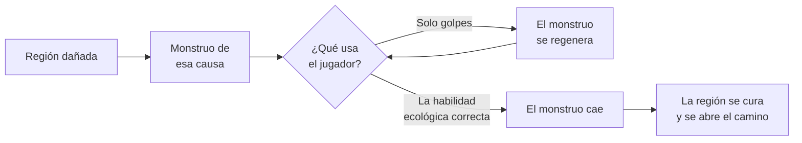
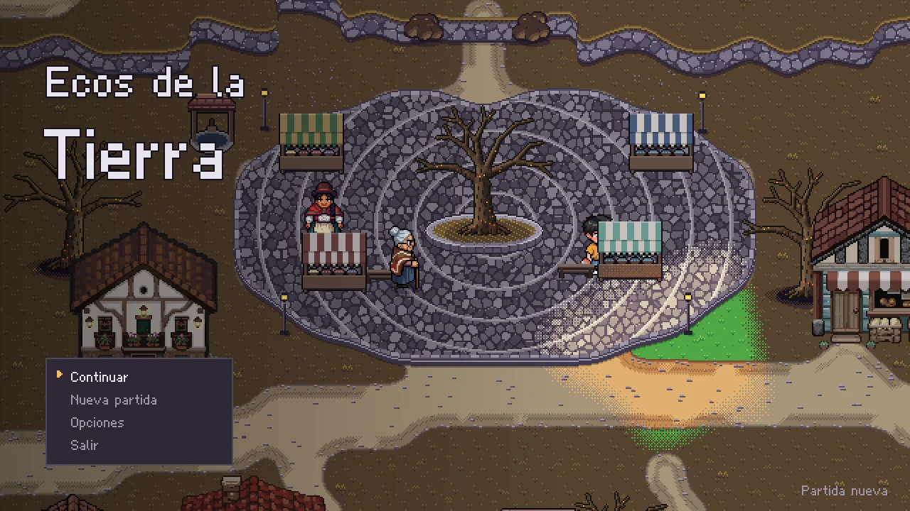
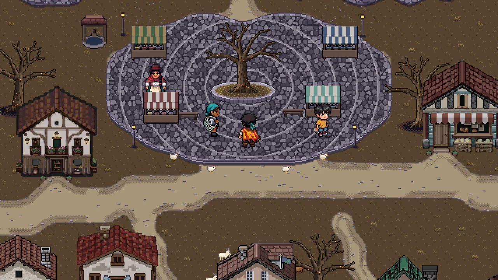
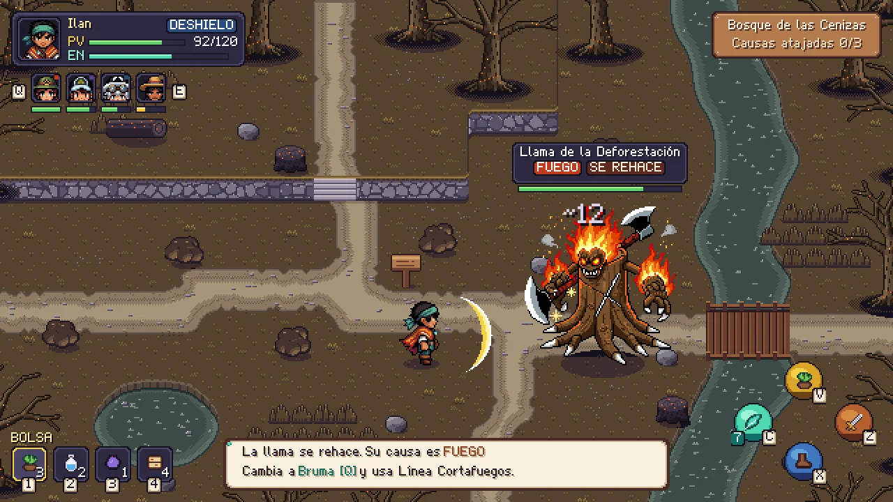
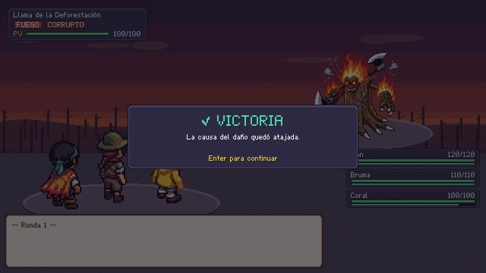

<div align="center">


# Ecos de la Tierra

**Al monstruo no se le gana a golpes. Se le gana atacando la causa.**

RPG 2D en pixel art sobre el cuidado del medio ambiente. Cada región está enferma<br/>
por un problema real, y solo la habilidad ecológica correcta la cura.


[Cómo jugarlo](#cómo-jugarlo) · [Controles](#controles) · [Propuesta completa](EcosDeLaTierra%20Propuesta%20Videojuego.md) · [Portafolio](https://mi-portafolio-beta-kohl.vercel.app)

</div>

---

## La idea

Los problemas ambientales no se arreglan atacando los síntomas. En Ecos de la Tierra esa idea no se lee en un texto, se juega. Cada monstruo nace de un daño real, como la deforestación o el monocultivo, y **se regenera** mientras el jugador no use la habilidad ecológica que ataja la causa. Cuando la usa, la región se cura y el color vuelve a la pantalla.



## Capturas

<div align="center">

| Pantalla de título | Valdehoja |
|:---:|:---:|
|  |  |
| **Combate contra la Llama de la Deforestación** | **Región purificada** |
|  |  |

</div>

## Qué se puede jugar hoy

La versión de `master` es la **demo hasta el primer jefe**, la que presentamos el 4 de noviembre de 2026.

1. Ilan empieza en **Valdehoja** y habla con Yara junto al semillero.
2. Sale por el este al **Bosque de las Cenizas** y se encuentra con el Comandante Rasgo.
3. Pelea contra la **Llama de la Deforestación**. Solo la Línea Cortafuegos de Bruma ataja la causa.
4. El bosque se cura, se abre el paso y la demo termina con un mensaje de lo que sigue en la historia.

## Qué tiene

### Combate de acción en el mismo mapa

- Manejas a un héroe, cambias entre los del grupo, golpeas, esquivas y usas las habilidades y la bolsa, que siempre están a la vista.
- **Debilidad ambiental.** Cada monstruo se regenera hasta que recibe la habilidad que ataja su causa.
- **Monstruos que piensan.** Deciden por pesos y el jefe final aprende con una tabla Q. Si repites siempre la misma habilidad la empieza a resistir, y toca combinarlas.

### Un mundo que se cura

- Regiones con su propio problema ambiental y su propio monstruo.
- El mundo está apagado y el color vuelve cuando el jugador purifica una región.
- Diálogos con la caja del sistema de diseño y personajes con retrato.

### Arte con sistema

- Todo lo visual sigue el sistema de diseño **«Tierra Viva»**.
- Personajes y monstruos del mapa hechos con PixelLab, y decorados y marcos generados por los scripts de `tools/`.

## Controles

| Acción | Tecla |
|---|---|
| Moverse | Flechas o `W` `A` `S` `D` |
| Correr | `Shift` |
| Hablar o confirmar | `Enter` o `Espacio` |
| Volver | `Esc` |
| Golpear | `Z` |
| Esquivar | `X` |
| Habilidad ecológica | `C` |
| Usar objeto | `V` |
| Cambiar de héroe | `Q` y `E` |
| Orden al grupo | `Tab` |

## Cómo jugarlo

1. Instala **[Godot 4.3 o superior](https://godotengine.org/download)**, la versión estándar. La .NET no hace falta porque el proyecto no usa C#. Lo probamos en 4.3 y en 4.7.2.
2. En Godot entra a **Import** y elige el `project.godot` de esta carpeta.
3. Dale **F5**. La escena principal es `scenes/game.tscn`.

En Windows también está `Jugar.bat`, que abre el juego sin el editor. Busca Godot 4.7.2 en la carpeta de Descargas, así que si lo tienes en otra parte toca cambiar la ruta dentro del archivo.

El juego no necesita cuenta ni internet.

### Correr las pruebas

Las verificaciones de movimiento, cámara, combate de acción, flujo y usabilidad corren sin interfaz.

```bash
godot --headless --path . --quit-after 3                 # comprobar que el proyecto abre
godot --headless --path . res://tools/verify_action_combat.tscn
```

## Stack

| Parte | Tecnología |
|---|---|
| Motor | Godot 4 |
| Lenguaje | GDScript, orientado a objetos con clases base (`Combatant`, `Monster`, `Skill`, `StatusEffect`, `Item`) |
| IA de los monstruos | Decisión por pesos y aprendizaje por refuerzo (tabla Q) en el jefe |
| Arte | PixelLab para personajes y scripts de Python para decorados, marcos y fuente |
| Exportación | PC y Android desde el mismo proyecto |

```
ecos-de-la-tierra
├── project.godot   configuración y mapa de teclas
├── scenes/         escenas (juego, batalla, mundo)
├── src/            todo el código (ver src/README.md)
├── assets/         sprites, mapas, audio y fuentes
├── data/           mapas de las regiones, salidas y datos de combate
├── tools/          generadores de arte y pruebas
└── docs/
    ├── ux/         sistema de diseño Tierra Viva y anexos
    ├── legal/      aviso de privacidad
    └── plan-para-terminar-la-historia.md
```

**Convenciones.** El código va en inglés (clases, métodos, variables y archivos) y el español en lo que ve el jugador y en los comentarios. Archivos en `snake_case` y clases en `PascalCase` con `class_name`. La lógica compartida vive en la clase base y no se repite en cada subclase.

## Cómo lo diseñamos

El juego tiene su propio sistema de diseño, «Tierra Viva», en `docs/ux/sistema-de-diseno/` (abre su `index.html`). Ahí están el mundo, las regiones, los interiores, el HUD de acción y cada componente. Cada pantalla pasó por investigación de referentes, propuestas, una elegida y verificación medida, y queda escrita en `docs/ux/anexos/`. Por ejemplo, el combate empezó por turnos en una pantalla aparte y lo cambiamos a acción en el mismo mapa porque por turnos se sentía como cualquier otro RPG de monstruos.

## Privacidad

El juego no recoge datos de nadie ni se conecta a internet. El detalle está en [`docs/legal/privacidad.md`](docs/legal/privacidad.md), y las licencias del audio en `docs/licencias-audio.md`.

## Hoja de ruta

El plan para acabar la historia está en [`docs/plan-para-terminar-la-historia.md`](docs/plan-para-terminar-la-historia.md).

- Las regiones que siguen después del Bosque de las Cenizas, cada una con su monstruo.
- El jefe final con la tabla Q.
- Guardado de partida.
- Exportar a Android.

---

<div align="center">

Proyecto final de **Diseño de Interfaces de Software** · 5.º semestre · Universidad Cooperativa de Colombia

Hecho por **Diego Armando Pinta Cuasquen** y **Juan José Rueda**

</div>
